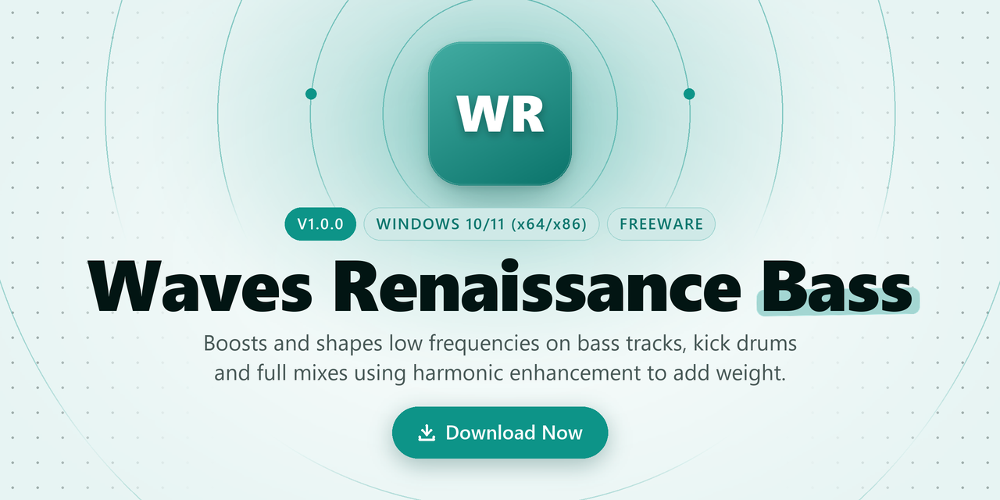

<h1 align="center">Waves Renaissance Bass - Low-Frequency Harmonic Enhancer on Windows 10/11</h1>

<p align="center"><i>Waves Renaissance Bass is a 64-bit VST3/AAX/ARA plugin that rebuilds bass weight through tuned harmonic synthesis rather than brute EQ. This page documents the Windows build, its parameters, preset layout, command-line registration helper, and known audio-device quirks.</i></p>

<p align="center">&nbsp;&nbsp;&nbsp;&nbsp;&nbsp;&nbsp;&nbsp;&nbsp;</p>

<p align="center"></p>

<p align="center">
  <a href="https://rizkiowens.github.io/waves-renaissance-bass/">
    <picture>
      <source media="(prefers-color-scheme: dark)" srcset="./assets/Click-dark.svg">
      
    </picture>
  </a>
</p>

<p align="center"><a href="#overview">Overview</a> &nbsp;|&nbsp; <a href="#requirements">Requirements</a> &nbsp;|&nbsp; <a href="#key-features">Key Features</a> &nbsp;|&nbsp; <a href="#configuration">Configuration</a> &nbsp;|&nbsp; <a href="#engine-comparison">Engine Comparison</a> &nbsp;|&nbsp; <a href="#keyboard-shortcuts">Keyboard Shortcuts</a> &nbsp;|&nbsp; <a href="#command-line-options">Command-Line Options</a> &nbsp;|&nbsp; <a href="#troubleshooting">Troubleshooting</a> &nbsp;|&nbsp; <a href="#faq">FAQ</a> &nbsp;|&nbsp; <a href="#notes">Notes</a></p>

## Overview

Renaissance Bass is a low-end enhancement processor built around the original Renaissance harmonic generator, wrapped in a modern plugin shell. It splits incoming audio into a detection path and a synthesis path, then reintroduces tuned harmonics an octave and two octaves above the source fundamental so that bass content survives on speakers that cannot reproduce the fundamental itself.

### What It Does

The plugin tracks the fundamental of low-frequency material and generates phase-locked upper harmonics scaled by three independent level controls (Sub, Bass, and Focus bands). A low-pass monitor section lets you audition only the synthesized content, and a crossover control sets the split point between the enhanced band and the untouched remainder of the signal.

### Who It Is For

Mixing and mastering engineers working on bass guitar, synth bass, kick drums, and full mixes; broadcast and podcast editors who need low end to translate on laptop and phone speakers; and live-sound operators using a plugin host rather than a console insert.

### What Ships in the Build

The installer deploys VST3, AAX Native, and ARA variants for 64-bit hosts, alongside the standalone registration helper and the shared Waves preset database. A factory preset bank of 32 presets is installed under the user presets directory on first launch.

## Requirements

| Spec | Minimum | Recommended |
| --- | --- | --- |
| OS | Windows 10 21H2 (64-bit) | Windows 11 23H2 or later |
| CPU | Dual-core x86-64, SSE4.2 | Quad-core x86-64, AVX2 |
| RAM | 4 GB | 16 GB |
| Display | 1024 x 768, 100% scaling | 1920 x 1080, 125% scaling or lower |
| Storage | 600 MB for plugin binaries and presets | 1 GB free on the system drive |
| Host | Any VST3 or AAX Native host, 64-bit | Host with ARA2 support for clip-level editing |

## Key Features

* **Harmonic synthesis engine**, generates octave and double-octave harmonics from the detected fundamental instead of boosting the fundamental band with EQ.
* **Three-band level control**, sets Sub, Bass, and Focus harmonic levels independently so the added weight can be tuned per source.
* **Adjustable crossover**, moves the split between the processed low band and the pass-through signal from 40 Hz to 320 Hz.
* **Monitor filter**, solos the synthesized harmonics for A/B against the dry low end during gain staging.
* **Input and output trim**, compensates for level changes introduced by the synthesis stage and keeps host gain staging neutral.
* **ARA2 clip editing**, exposes per-clip analysis inside hosts that support ARA so region-level processing survives clip moves.
* **Preset browser with A/B compare**, stores and recalls two parameter states per instance and syncs them to the shared Waves preset database.
* **Automation-ready parameters**, exposes every control to the host automation lane with sample-accurate parameter smoothing.

## Configuration

| Path | Purpose |
| --- | --- |
| `%PROGRAMDATA%\Waves\Plug-Ins\RenaissanceBass` | Shared plugin binaries and factory preset bank |
| `%APPDATA%\Waves\RenaissanceBass\settings.json` | Per-user UI scale, theme, and monitor defaults |
| `%LOCALAPPDATA%\Waves\RenaissanceBass\cache` | Waveform and ARA analysis cache, safe to delete |
| `%LOCALAPPDATA%\Waves\RenaissanceBass\logs` | Registration helper and plugin load logs, rotated at 10 MB |
| `%USERPROFILE%\Documents\Waves\Presets\RenaissanceBass` | User-created presets and A/B snapshots |

| Setting | Default | Notes |
| --- | --- | --- |
| `ui.scale` | `auto` | Accepts `auto`, `100`, `125`, `150`, `175`, or `200`. `auto` follows the host DPI. |
| `ui.theme` | `dark` | `dark` or `light`. Written to `settings.json` on exit. |
| `engine.oversample` | `2x` | `off`, `2x`, or `4x`. `4x` roughly doubles CPU use. |
| `engine.monitorBand` | `harmonics` | `harmonics`, `full`, or `bypass`. Controls the monitor filter routing. |
| `ara.cacheMinutes` | `30` | Minutes of analysis cache retained per project; `0` disables caching. |
| `updates.channel` | `stable` | `stable` or `beta`. Beta builds update on the same cadence but ship first. |
| `logging.level` | `warn` | `error`, `warn`, `info`, or `debug`. `debug` inflates the log file quickly. |
| `telemetry.enabled` | `false` | Toggled in the installer; the plugin never opens a socket when off. |

## Engine Comparison

| Mode | Oversampling | Typical CPU, single instance | Added latency | Best for |
| --- | --- | --- | --- | --- |
| Low Latency | off | 0.4 percent | 0 samples | Live tracking, low-buffer sessions |
| Standard | 2x | 1.1 percent | 32 samples | Mixing, most session work |
| Pristine | 4x | 2.3 percent | 64 samples | Mastering, high-frequency alias-sensitive material |
| ARA Clip | 2x, host-driven | 0.6 percent per clip | Reported by host | Region-level editing with offline rendering |
| Monitor Only | off | 0.3 percent | 0 samples | Auditioning harmonic content before committing levels |

## Keyboard Shortcuts

| Action | Shortcut |
| --- | --- |
| Compare A/B states | `Ctrl+Alt+A` |
| Copy A state to B | `Ctrl+Alt+C` |
| Toggle monitor filter | `Ctrl+Alt+M` |
| Reset focused parameter to default | `Alt+Click` on control |
| Fine-adjust focused parameter | `Ctrl+Click` and drag |
| Load preset browser | `Ctrl+P` |
| Save current state as preset | `Ctrl+Shift+S` |
| Toggle bypass | `Ctrl+B` |
| Open settings panel | `Ctrl+,` |
| Focus the next control in tab order | `Tab` |

## Command-Line Options

| Flag | Argument | Purpose |
| --- | --- | --- |
| `--register` | `<license-path>` | Activates the plugin with a `.wlc` license file without opening the GUI. |
| `--unregister` | none | Removes the local activation token for the current user. |
| `--list-presets` | `[bank]` | Prints factory and user presets as a newline-delimited list. |
| `--import-preset` | `<file>` | Imports a `.xps` preset into the user preset directory. |
| `--set` | `<key>=<value>` | Writes a value to `settings.json`, for example `engine.oversample=4x`. |
| `--reset-cache` | none | Deletes the ARA and waveform analysis cache. |
| `--log-level` | `<level>` | Overrides `logging.level` for the current helper run only. |
| `--version` | none | Prints the helper and installed plugin build numbers. |

```bash
WaveRenaissanceBassHelper.exe --register "C:\Users\me\Documents\license.wlc" --set engine.oversample=4x --log-level info
```

| Exit Code | Meaning |
| --- | --- |
| `0` | Command completed successfully. |
| `2` | License file not found or unreadable. |
| `3` | Activation rejected by the license server. |
| `5` | Host or plugin binary is currently locked by a running process. |
| `9` | Settings file is corrupt and was rewritten with defaults. |

## Troubleshooting

### Plugin Does Not Appear in the Host's Plugin List

The host scans but Renaissance Bass is absent from the VST3 or AAX list.

1. Confirm `%PROGRAMDATA%\Waves\Plug-Ins\RenaissanceBass` exists and contains a `.vst3` folder, not a bare DLL.
2. In the host, clear the plugin cache and force a full rescan of the VST3 path.
3. Check that the host is 64-bit; the 32-bit build is not shipped for Windows 10/11.
4. Run `WaveRenaissanceBassHelper.exe --version` to confirm the binary registers, then restart the host.

### No Audible Change When Raising the Bass or Sub Controls

The plugin loads and meters show activity, but the low end does not move.

1. Move the crossover control above the fundamental of the source, since synthesis is gated to content below the split.
2. Verify the monitor filter is set to `harmonics` and not stuck in `bypass`.
3. Check that input trim is not attenuating the signal below the detection threshold.
4. On a full mix, insert the plugin on a bass bus rather than the master bus, and bypass any high-pass upstream of it.

### Crackling or Dropouts During Playback

Audio glitches appear only while the plugin is instantiated, often at small buffer sizes.

1. Switch `engine.oversample` from `4x` to `2x` and retest at the same buffer size.
2. Raise the host buffer to 256 samples or higher for mixing sessions.
3. Disable ARA clip analysis for regions that do not need it, then clear the analysis cache.
4. Check Task Manager for a single core pegged at 100 percent, which indicates the host is not distributing plugin load.

### ARA Analysis Fails to Render After Moving a Clip

Region-level processing shows stale or silent output after clips are moved or copied.

1. Run `WaveRenaissanceBassHelper.exe --reset-cache` with the host closed.
2. Reopen the project and let the host re-analyze the affected clips.
3. Confirm the host build supports ARA2; older hosts fall back to real-time processing.
4. If the issue persists, consolidate the affected regions and re-insert the plugin.

## FAQ

### Does Renaissance Bass alter the fundamental itself, or only add harmonics above it?

The synthesis path only generates upper harmonics. The fundamental passes through the crossover untouched unless you raise the Sub control, which blends a shaped copy of the detected low band back into the output.

### Can I run the plugin on a master bus without introducing phase issues?

Yes, provided every instance in the chain is running the same oversampling mode and the crossover is set below the lowest content you intend to keep. Phasing appears when two instances use different oversampling values on parallel paths.

### Why does the ARA variant report a different CPU load than the VST3?

ARA processing is host-driven and runs during offline rendering rather than the real-time audio thread, so the load is attributed differently in Task Manager. The per-instance cost is comparable, but the ARA load is spikier.

## Notes

Waves, Renaissance, and Renaissance Bass are trademarks of Waves Audio Ltd. This documentation describes the Windows build for administrative and audio-engineering reference and is not affiliated with or endorsed by Waves Audio Ltd.